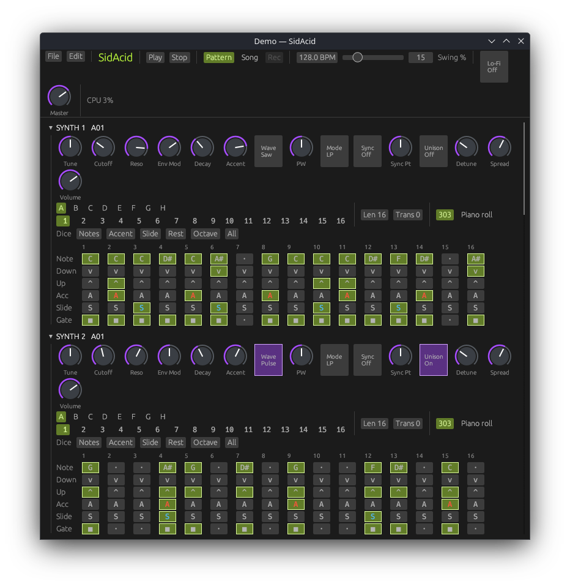
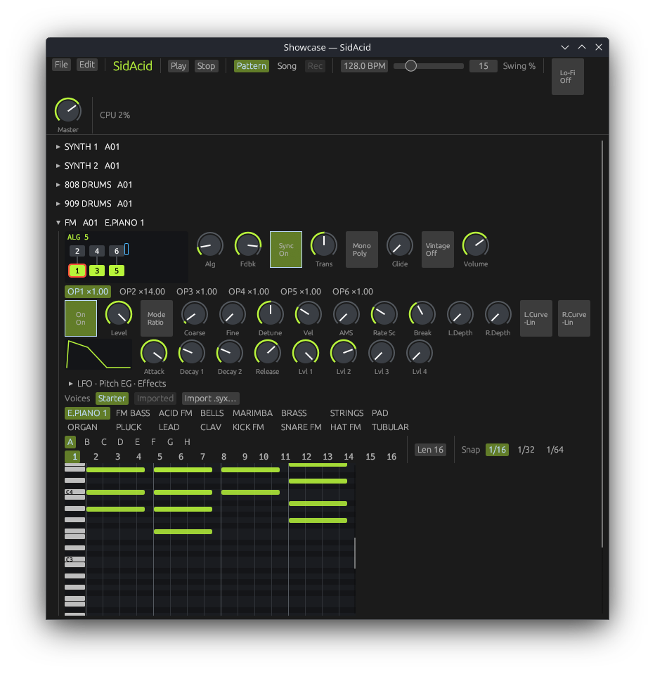

# SidAcid

An acid groovebox built on a sound engine modelled on a classic 8-bit home-computer sound chip. It runs as a native desktop app and is laid out for a 1280×800 handheld screen.



<p>
  
  
</p>

## What's in the box

- **Two 8-bit chip bass synths with classic acid-bass controls:**
  - Tune, Cutoff, Resonance, Env Mod, Decay and Accent.
  - Saw or pulse wave, LP/BP/HP filter, hard sync.
  - Accent sweep that builds over consecutive accents, and slide/tie.
  - 3-voice detuned **unison** with stereo spread.
- **Two 8-bit chip drum machines:**
  - Two kits in the style of classic analog drum machines: BD, SD, LT, HT, CP, RS, CH and OH.
  - Tune, Decay, Tone and Level per instrument.
  - Closed hat chokes open hat.
- **FM synth** in the style of classic 6-operator FM synths:
  - 6 operators, 32 algorithms with a live algorithm diagram, 4-rate / 4-level envelopes, keyboard and velocity scaling.
  - LFO and pitch EG.
  - 12-voice poly, or mono with glide.
  - Filter, chorus and phaser, plus a Vintage switch for 12-bit grit.
  - A 16-voice starter bank, and **.syx import** of standard 6-operator FM SysEx files (32-voice banks or single voices).
- **Mono synth**, a virtual-analog mono voice:
  - One band-limited saw and pulse oscillator, a phase-locked sub oscillator (one octave down square, two octaves down square, or a two-octave-down 25% pulse) and a noise source, each with its own level. Range switch (-12 / 0 / +12 / +24 semitones) and fine Tune.
  - Pulse width from the PW knob, the LFO or the envelope. The LFO can also modulate pitch (VCO Mod).
  - 4-pole (24 dB/oct) resonant ladder low-pass filter that self-oscillates at full resonance. Cutoff is moved by the envelope, the LFO, key tracking and velocity.
  - One ADSR envelope with a Trigger switch (every note, only after a gap, or each LFO cycle) and a VCA switch (envelope or gate). Velocity can scale both filter and volume.
  - LFO with triangle, square, sample-and-hold or noise waves.
  - Glide (portamento) set to Off, On or Auto (only between overlapping notes), with its own time. Monophonic, last-note priority.
  - **Arpeggiator** over the held notes: Up, Up-Down or Down, over 1 to 3 octaves, at 1/4, 1/8, 1/8T, 1/16, 1/16T or 1/32. It follows the transport and restarts at each song block.
  - Drift (slow pitch and cutoff wander), a stereo chorus (rate, depth, mix) and Volume.
  - A 14-patch starter bank (basses, leads, zaps, a noise snare, an arp pluck, a sweep and a pad) plus **Randomise**, a new sound that always plays and keeps volume, drift and chorus. It keeps the arp too, unless it makes a blip sound: that turns the arp on at 1/16 with a random mode and range. Loading a patch is one undo step. Panel shows an envelope sketch.
- **Sampler** with 16 slots:
  - **Slice mode** for breaks: chop into 4/8/16/32 equal slices or by detected transients, drag the slice markers, and use choke and tempo lock.
  - **Chromatic mode** for voices and stabs: root key, start/end, and a crossfaded loop.
  - Per slot: level, pan, tune, filter, ADSR and reverse. Grit adds vintage-sampler-style 12-bit, 26 kHz crunch.
  - Load WAV, FLAC, MP3 or OGG with Load… or by dragging the file onto the panel. Audio is saved inside the project file. Sample rates from 8 to 192 kHz are accepted; there is no resampling filter, so samples above 48 kHz, or pitched up an octave or more, may alias.
- **Editor dock:**
  - Every part's pattern sits in a resizable dock at the bottom, as stacked lanes on one shared time ruler. Snap runs from 1/4 to 1/64, with zoom and follow-playhead; a thumb strip along the bottom of the ruler is the horizontal scrollbar.
  - Melodic lanes have a key strip and their own pitch scroll: chords on the FM synth and sampler, one note at a time on the bass synths with slides drawn as ties. Sampler rows are labelled with their slot and slice.
  - Drum lanes have eight labelled rows, and hits can sit at any snap.
  - **Key and scale:** in Pattern mode the dock header picks the project's root and scale (Chromatic, Minor, Melodic minor, Phrygian, Major, Hungarian minor). Melodic lanes shade off-scale rows and mark the root; drum lanes ignore the key.
  - **Snap to scale:** new, typed and dragged notes and Up/Down transposes land on scale degrees (Shift+Up/Down still moves an octave).
  - **Fold:** each melodic lane has a Fold toggle that hides off-scale rows. Rows that hold notes stay visible, and the keyboard cursor always stays on a shown row (a hidden pitch counts as the row below it).
  - Each lane has a header (collapse, pattern label, Strip toggle) and a handle to change its height. In Pattern mode the header shows "+N hidden" when N notes start past the pattern's end (after it was shortened): they are silent and come back if the pattern is lengthened.
  - An expression strip per lane: velocity, or accent and slide on the bass synths, or accent on the drums. The drum accent strip accents every hit on a step; double-click a hit to toggle its own accent. With the strip open, the lane header switches it between that view (Vel, Acc/Slide or Acc), Chance and Ratchet; the Chance and Ratchet strips draw a bar per note, edited by click or drag like velocity.
  - **Tools:** in Pattern mode the inspector row starts with a Tools menu that acts on the focused lane's selection, or every note in the pattern when nothing is selected (generators then fill the whole pattern). Each tool opens a small window with its settings and previews live; Apply makes one undo step, while Cancel (or closing the window, or Esc, even after a click in the window) puts the pattern back. Timing tools keep notes inside the pattern, so none slip past its end. Other edits on that lane are held while a tool is open. Tools aren't shown in Song mode.
    - **Quantize** (grid, strength %, ends), **Humanize** (timing ± ticks, velocity ±, seed), **Legato** (each note runs to the next note in the lane), **Reverse**, **Invert** (melodic only; snaps to the key when Snap to scale is on).
    - **Strum** (ticks between notes, up or down) and **Arpeggiate** (up, down, up-down or random; rate and gate; turns chords into runs) need a lane that plays chords (not drums or the bass synths).
    - **Randomize in scale** (density, pitch range, length range, seed; on drums one step per hit) follows the project key; **Euclidean** (hits, steps, rotation, pitch or drum row) repeats its cycle across the selection's time span, or the whole pattern.
  - **Note inspector:** in Pattern mode, with notes selected in the focused lane, the dock header edits them all at once: Vel (not on the bass synths), Chance, Ratchet, Cond, and Accent (bass synths and drums) and Slide (bass synths). A field the notes differ in shows "–". Each change is one undo step and the notes stay selected. **Reroll**, next to Chance, gives every chance in the project new dice (one undo step).
  - Notes with a chance below 100 % or a condition get a dashed outline, and a badge when wide enough to show it: the condition ("1:4", "1st", "!1st", "F", "!F", "P", "!P"), the chance ("50%") and the ratchet ("×3").
  - Type notes with the keyboard: click a lane to focus it, then use the tracker layout (Z S X D C V G B H N J M and Q 2 W 3 E R 5 T 6 Y 7 U I). Arrows move the cursor and Backspace steps back and deletes. Clicking outside the dock turns keyboard entry off.
  - Select notes: click one (Shift-click toggles), or drag on empty space to box-select (Shift adds). Drag the selection to move it; Ctrl-drag moves copies, and Alt moves in single 1/64 ticks. Drag a note's right edge to resize the whole selection. Right-click deletes (the whole selection if the note is selected).
  - Drag along the ruler, above the thumb strip, to select a time range across every lane; a click on the ruler clears it.
  - With the dock focused: Left/Right nudge the selection one snap (Alt: one tick); Up/Down transpose a semitone, or move a drum row (Shift: an octave, melodic lanes only); Delete or Backspace removes it; Esc clears it; Ctrl+A selects the whole lane.
  - Ctrl+C / Ctrl+X / Ctrl+V copy, cut and paste notes at the cursor (with nothing selected Ctrl+C copies the whole lane and Ctrl+X does nothing), and Ctrl+D duplicates right after the selection. With a ruler range these act on every lane at once, pasting back into the same machines, and Ctrl+D repeats the block. Without dock focus, Ctrl+C / Ctrl+V copy whole patterns as before.
  - The rack above keeps the knobs, pads, Len/Trans and dice.
- **Chance, ratchet and conditions** (every note, on every machine):
  - **Chance** (0–100 %): how likely the note is to play on each pass. The dice are fixed by the project's seed, so a project plays, re-renders and exports the same every time until you Reroll.
  - **Ratchet** (1–8): the note re-triggers that many times inside its length, evenly spaced: each hit lands at its exact fraction of the note, between the 1/64 ticks if need be, so a one-step note with ratchet 8 plays 8 hits a 1/128 note apart. On the bass synths each hit is a fresh gate, and a slide applies after the last hit.
  - **Conditions:** Always; 1:2 … 8:8 (a:b plays on pass a of every b passes of its pattern); First and Not first (the first pass or every other); Fill and Not fill (while Fill is on, or off); Pre and Not pre (whether the lane's previous conditional note played). A note's condition is checked first, then its chance.
  - Each lane counts the passes of its pattern from Play, from the start of its song block, and from a queued pattern switch.
  - **Fill:** the transport's Fill button is on while held; Shift-click latches it on or off. It lights while on.
- **Patterns:** 128 per machine, in banks A–H × 16. Each pattern is up to 64 steps, and a pattern switch queues to the next loop.
- **Mixer and effects:**
  - Six channels with per-channel distortion (2× oversampled) and compressor, level, pan, mute and solo.
  - Delay sends (tempo-synced, ping-pong) and reverb sends.
  - Master compressor, an 8-bit lo-fi switch, and meters.
- **Song mode:**
  - One lane of pattern blocks per machine. Blocks never overlap, gaps are silence, and the song ends at its last block (or where a converted song ended, if later).
  - A block follows its pattern's length; drag its right edge to fix a length (longer loops the pattern, shorter plays its start). Lengthening a pattern pushes later blocks on that lane right.
  - Double-click empty space to place the machine's selected pattern, or a block to open it in Pattern mode. Click, Shift-click or box select; drag to move by bars (Alt: steps) with the group's layout kept; Ctrl-drag copies; right-click deletes; arrow keys, Delete and Ctrl+C/X/V/D/A work on blocks.
  - The ruler shows bars: click to set the song start, drag to select a range. Loop the range (a loop reaching past the song's end extends the song, so it still loops), or insert or delete time across every lane (inserting inside a block leaves that block where it is; it isn't split). Capture places every machine's selected pattern at the song start.
  - A selected block has its own pattern, Mute and Transpose.
  - **Record** pattern changes as blocks, and knob moves. Only the knobs you touch get overwritten, and each record pass is one undo step.
  - The Mono arpeggiator restarts at each block. Older projects convert and play the same.
- **Smart randomise:**
  - Synth dice for Notes, Accent, Slide, Rest and Octave, with scales, groove-aware note placement, and slides that chain.
  - Drum Template and Evolve.
- **Files and editing:**
  - 200-level undo, and pattern copy/paste.
  - `.sidacid` project files.
  - WAV export of a loop or the whole song.

## Build and run

You need Rust 1.88+ (edition 2024, let-chains) and ALSA development files on Linux.

```sh
cargo run --release -p sidacid                         # the app
cargo run --release -p sidacid -- render-demo out.wav  # render the demo groove offline
cargo test --workspace                                 # run the tests
```

### Audio drivers

Linux builds include ALSA (which covers PipeWire and PulseAudio) and JACK.
JACK is loaded at runtime: without `libjack` it just isn't offered. The
build only needs pkg-config to report "jack"; `.cargo/config.toml` points
it at a stub in `support/pkgconfig/` unless you set `PKG_CONFIG_PATH`
yourself.

Windows builds include WASAPI. For ASIO, build on Windows with MSVC:

1. Download the Steinberg ASIO SDK and unzip it; set `CPAL_ASIO_DIR` to
   that folder.
2. Install LLVM and set `LIBCLANG_PATH` to its `bin` folder.
3. `cargo build --release -p sidacid --features asio`

Pick the driver and device under **File → Audio Settings…**.

## Keys

| Key | Action |
|---|---|
| Space | Play / stop. Pressing Stop while stopped returns to the song start. |
| Ctrl+Z / Ctrl+Y | Undo / redo |
| Ctrl+C / Ctrl+V | Copy / paste a pattern |
| Ctrl+S / Ctrl+O / Ctrl+N | Save / open / new |

## Layout

| Crate | What it is |
|---|---|
| `crates/sid-core` | The 8-bit sound chip: oscillators, envelopes, filter and 3-voice chip. No dependencies. |
| `crates/acid-engine` | The engine: synths, drums, effects, mixer, sequencer, song mode, randomisers, project files and offline render. It has no GUI or audio-device dependencies. |
| `crates/app` | The `sidacid` binary: egui UI and cpal live audio, with a lock-free command/event bridge to the audio thread. |

Design specs and implementation plans are in `docs/superpowers/`.

## Credits

The sound-chip engine is derived from the synthesiser in [Acid OS](https://github.com/NorfolkHacker/Acid-OS-V3), MIT licensed. See `THIRD_PARTY_NOTICES.md`.

SidAcid is MIT licensed; see `LICENSE`.
