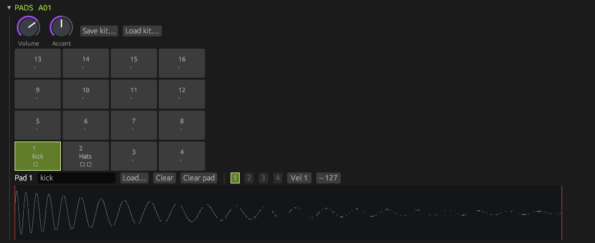

# Pad Kit

The Pad Kit is a sample drum machine. It has 16 pads, and each pad holds up to four samples (layers) that play at different velocities. This chapter covers the panel, pads and layers, the pad knobs, accents and velocity, mute groups, One-shot and Gate play, loading audio, saving and loading whole kits, the pad lane in the editor dock, and voices.

## The panel

From top to bottom, the Pad Kit panel holds:

1. The kit knobs **Volume** and **Accent**, and the **Save kit…** and **Load kit…** buttons (see [Kit files](#kit-files)).
2. The 16 pads in a 4×4 grid.
3. The pad row for the selected pad: its number, its name, **Load…**, **Clear**, **Clear pad**, the layer tabs and the velocity range of the selected layer.
4. The waveform of the selected layer, with **Start** and **End** markers.
5. The selected pad's knobs (see [Pad knobs](#pad-knobs)).
6. The pattern pads and **Len** box, the same as on the other machines (see [The rack and patterns](rack-and-patterns.md)). The notes themselves are edited in the [editor dock](editor-dock.md).

The panel title shows the machine's name and its selected pattern. New Pad Kits are named "Pads", "Pads 2" and so on.

| Control | What it does | Range | Default |
|---|---|---|---|
| **Volume** | The Pad Kit's output level, before its mixer channel. | Silent to full | 70% |
| **Accent** | How much an accented hit adds to its velocity. See [Accents and velocity](#accents-and-velocity). | 0–100% | 50% |

## Pads and layers

A pad is up to four *layers*. A layer is one sample with a velocity range, and the layer whose range contains a hit's velocity is the one that plays. The pad's knobs apply to whichever layer plays.

Pad 1 is at the bottom left of the grid and pad 13 at the top left, so the grid reads like the pad lane: the lowest pad is at the bottom. Each button shows the pad number, the first 8 characters of its name and a dot for each layer. An empty pad shows "·".

- **Click a pad** to select it. The pad row, the waveform and the pad knobs show the selected pad.
- **Click and hold a pad** to hear it, at velocity 100, until you let go of the mouse button. An empty pad makes no sound.
- **Click a layer tab** (1 to 4) to select a layer. Tabs for layers the pad doesn't have are greyed out.
- Pads that are sounding, from the audition or from notes under the playhead, get a bright outline.

The name field in the pad row shows the pad's name. Until you type one, a pad is named after its first layer's file, or "P1" to "P16" when it is empty. Press Enter or click away to rename, and Esc to cancel. Naming a pad with an empty name goes back to the automatic one. **Clear** removes the selected layer, and the ranges of the layers that are left are split evenly again (see [Velocity layers](#velocity-layers)). **Clear pad** empties the whole pad, name included.

### Velocity layers

Each layer plays for velocities from its low end to its high end, both between 1 and 127. Two **Vel** boxes in the pad row show and set the selected layer's range: drag a value or type one.

When you add or remove a layer, the pad's layers are split evenly:

| Layers | Ranges |
|---|---|
| 1 | 1–127 |
| 2 | 1–63, 64–127 |
| 3 | 1–42, 43–85, 86–127 |
| 4 | 1–31, 32–63, 64–95, 96–127 |

You can then change any range by hand. The ranges don't have to fit together. A velocity that no layer covers plays nothing, and when ranges overlap, the first layer (lowest tab number) wins.

## Pad knobs

These knobs and switches belong to the selected pad. Click another pad to see and change that pad's settings. Hover over a knob to see its name and its value as a percentage of the knob's travel; the table below gives what that travel means. See [Getting started](getting-started.md) for how to use knobs and switches.

| Control | What it does | Range or positions | Default |
|---|---|---|---|
| **Tune** | Pitch, in semitones and fractions of one. | −24 to +24 semitones | 0 |
| **Decay** | How long the pad plays. At its top position the sample plays out. Below that, the sound fades over this time. | 10 ms to 4 s, or open | Open |
| **Level** | The pad's volume. It uses the same curve as the [drum kits](drum-kits.md): half of the knob's travel is a quarter of the volume. | Silent to full | 80% |
| **Pan** | Places the pad in the stereo field (equal-power). | Left to right | Centre |
| **Cutoff** | Cutoff of a resonant low-pass filter. At full Cutoff and zero **Res**, the filter is off. | 20 Hz to 20000 Hz | 20000 Hz (off) |
| **Res** | Filter resonance. | 0–100% | 0% |
| **Start** | Where in the sample playing begins. | 0–100% of the sample | 0% |
| **End** | Where playing ends. | 0–100% of the sample | 100% |
| **Reverse** | Plays the part between Start and End backwards. | Off, On | Off |
| **Mode** | One-shot or Gate. See [One-shot and Gate](#one-shot-and-gate). | One-shot, Gate | One-shot |
| **Mute** | The pad's mute group. See [Mute groups](#mute-groups). | Off, 1, 2, 3, 4 | Off |

**Start** and **End** are also markers on the waveform. Drag them to trim the sample. They can't pass each other, and each drag is one undo step. While Reverse is on, the waveform is drawn mirrored so it reads in the order it plays.

The knobs are the same for every layer of a pad. Start and End are fractions of the layer that plays, so two layers of different lengths are trimmed by the same share.

A new note uses a pad's settings when it starts, so changes to Tune, Start, End and Reverse take effect from the next hit.

## Accents and velocity

A hit's velocity (1 to 127) chooses the layer and sets the hit's volume. A hit that is accented in the pattern adds a bonus to its velocity before the layer is chosen: the **Accent** knob's value times 127, rounded down, up to a total of 127. At the default of 50%, an accent adds 63. A hit at velocity 40 with accent therefore plays as velocity 103, which may be a louder layer.

In the pad lane an accented hit has a coloured line along its top. See [The pad lane](#the-pad-lane).

## Mute groups

Pads in the same mute group cut each other off, like an open and a closed hi-hat. When a pad in group 1 to 4 starts, any held notes of other pads in the same group fade out over 5 ms. **Off** puts a pad in no group.

A pad also cuts its own previous hit: hitting it again fades out the earlier one over 5 ms rather than layering the two.

## One-shot and Gate

- **One-shot** pads play until the sample ends (or **Decay** closes it), whatever the length of the note in the pattern. Use it for drum hits.
- **Gate** pads play only while the note lasts. When the note ends, the sound fades out over 5 ms. Use it for sustained sounds and loops, with the note resized to the length you want.

When you hold a pad (or its key in the lane), a Gate pad stops when you let go. When the pattern stops, Gate pads stop, and One-shot pads finish playing.

## Loading audio

You can load WAV, FLAC, MP3 and OGG (Vorbis) files. The limits are the same as for the Sampler: 8 kHz to 192 kHz, at most 30 seconds, mono or stereo (see [Limits](sampler.md#limits)). A pad's layers are stored 16-bit in the project, like the Sampler's.

To load a file with the file browser:

1. Click a pad to select it.
2. Click **Load…**.
3. Pick the file.

The file becomes a new layer on the pad, named after the file (cut to 24 characters), and the pad's layers are split evenly. If the pad already has four layers, the file replaces the selected layer, keeping that layer's velocity range.

To load files by dragging, drop one or more audio files onto the pad grid:

- A dropped file goes onto the pad under the pointer, even if another machine is selected.
- Several files fill consecutive pads, starting from the pad under the pointer. Files past pad 16 are ignored.
- On a pad that already has four layers, a dropped file replaces the selected layer if that pad is the selected pad, and otherwise the pad's last layer.
- One memory check covers the whole drop. If loading would leave the system short of free memory, SidAcid shows a "Low memory" window, and you choose **Go ahead** or **Cancel** (see [the low-memory warning](mixer-and-effects.md#the-low-memory-warning)).
- A file that can't be loaded is skipped, and the next file takes its pad. One message lists the files that didn't load, with "Loaded n of m files." at the top.

A file dropped anywhere else on the window goes into the focused machine if it is a Pad Kit (starting from its selected pad) or a Sampler. Otherwise it goes into the first Sampler in the rack, or failing that the first Pad Kit.

Loading, clearing, renaming and changing a range are undo steps (see [Files and export](files-and-export.md#undo-and-redo)). There is no fixed sample memory; the samples count toward the **MEM** readout in the transport bar.

## Kit files

A kit file holds a whole Pad Kit: all 16 pads with their layers and velocity ranges, and the values of the kit's and the pads' knobs. It has the extension `.padkit`. Patterns, the mixer channel and the machine's name aren't part of it, so you can load a kit into a machine without disturbing its patterns.

- **Save kit…** asks for a file name. If the file already exists, the system's save dialog asks before writing over it. If you type a name without `.padkit`, SidAcid adds the extension, and if a file with that full name already exists, SidAcid asks "Replace file?" itself.
- **Load kit…** asks for a `.padkit` file and replaces all 16 pads and every kit and pad knob. It is one undo step. Knobs that the file doesn't mention go back to their defaults. The patterns stay as they are. The memory check applies here too.

A broken kit is refused whole and nothing changes. The message names the pad at fault, for example "Could not load the kit: pad 3: layer 2: …". A kit file of a newer version, or with a wrong number of pads, is refused as well.

## The pad lane

The Pad Kit's pattern is a lane in the [editor dock](editor-dock.md). It has 16 rows, one per pad, named after the pads, with pad 1 at the bottom. A lane works like the drum lanes, with these differences:

- Notes can be resized, which matters for Gate pads. Drum hits can't be.
- The strip below the grid has a **Vel** mode: one bar per note, its height the velocity. Notes are shaded by velocity too.
- Double-click a note to turn its accent on or off.
- **Invert** isn't available on a pad lane ("Melodic lanes only"). Strum and Arpeggiate aren't either, as on the drum lanes.
- The lane ignores the project key.

A new note starts at velocity 100.

A new Pad Kit's lane is taller than the other lanes, so every row has room for its name. If you make the lane so short that the names would overlap, they are hidden.

## Voices

All 16 pads share 16 voices, so up to 16 sounds play at once. A new hit takes a free voice if there is one. Otherwise it takes a voice that is only playing out the short fade of a sound that was cut off, and failing that the oldest voice.

See also: [Sampler](sampler.md) · [Drum kits](drum-kits.md) · [Editor dock](editor-dock.md) · [The rack and patterns](rack-and-patterns.md) · [Mixer and effects](mixer-and-effects.md) · [Files and export](files-and-export.md)
