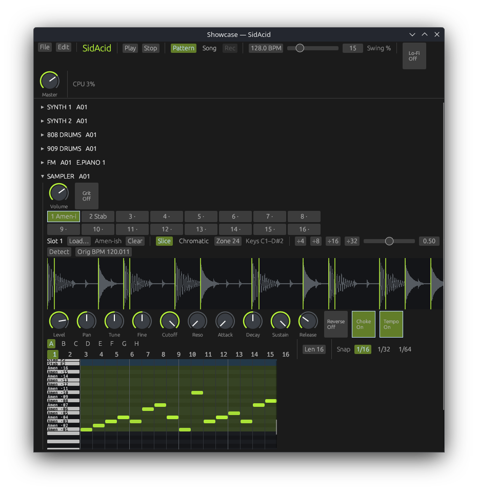

# Sampler

The Sampler plays audio files you load into it. It has 16 slots, and each slot holds one sample in one of two modes: Slice mode chops a drum break or loop into slices that each play from their own key, and Chromatic mode plays one sound up and down the keyboard. This chapter covers loading audio, both modes, the per-slot knobs, Grit, the memory limit, and how sampler notes look in the editor dock.

## The panel

From top to bottom, the Sampler panel holds:

1. The machine knobs: **Volume** and the **Grit** switch (see [Volume and Grit](#volume-and-grit)).
2. The 16 slot pads, in two rows of eight.
3. The slot row for the selected slot: its number, **Load…**, the sample name, **Clear**, the mode buttons and the zone and slice controls.
4. The waveform of the selected slot, with its markers.
5. The selected slot's knobs (see [Slot knobs](#slot-knobs)).
6. The pattern pads and **Len** box, the same as on the FM and Mono synths (see [The rack and patterns](rack-and-patterns.md)). The notes themselves are edited in the [editor dock](editor-dock.md).

The panel title shows the machine's name and its selected pattern, for example "SAMPLER   A01".

## Slots and pads

A slot is one sample plus its settings: its mode, its zone of keys, its slice or loop markers, and its own knobs. The Sampler has 16 slots.

Each pad shows the slot number and the first six characters of the sample's name. An empty slot shows "·".

- **Click a pad** to select that slot. The slot row, the waveform and the slot knobs all show the selected slot.
- **Shift-click and hold a pad** to hear the slot. It plays the first slice (Slice mode) or the root key (Chromatic mode) until you let go of the mouse button. An empty slot makes no sound.

All 16 slots share 16 voices, so up to 16 notes sound at once. When every voice is busy, a new note takes the voice of the oldest note that has already been released, or failing that the oldest note.

## Loading audio

You can load WAV, FLAC, MP3 and OGG (Vorbis) files.

To load a file with the file browser:

1. Click a pad to select the slot.
2. Click **Load…**.
3. Pick the file.

To load a file by dragging:

1. Click a pad to select the slot.
2. Drag the audio file from your file manager and drop it anywhere on the SidAcid window.

A dropped file goes into the selected slot of the focused Sampler. If the focused machine is not a Sampler or a [Pad Kit](pad-kit.md), it goes into the first Sampler in the rack. Dropped onto a Pad Kit's pad grid, it goes to the pad instead.

Loading into a slot that already holds a sample replaces it. **Clear** empties the slot. Both can be undone (see [Files and export](files-and-export.md)).

### What happens when a file loads

- A file of **1 second or longer** loads in Slice mode. SidAcid looks for transients at a sensitivity of 0.5 and puts a slice at each one. If it finds fewer than two, it cuts the sample into 8 equal slices instead. It also guesses the sample's tempo for **Orig BPM**, and turns the slot's **Choke** and **Tempo** switches on.
- A file **shorter than 1 second** loads in Chromatic mode, with a zone of 24 keys and the root key at the bottom of the zone.
- The new zone goes on the lowest free keys from C1 upward, where it does not overlap another slot's zone. If there is no room, the load is refused with "No free keys left for this sample's zone. Move or clear another slot."
- Every slot knob goes back to its default (apart from Choke and Tempo in Slice mode, as above).
- The slot takes the file's name, cut to 24 characters.

### Limits

| Limit | Value |
|---|---|
| Sample rate | 8 kHz to 192 kHz. Other rates are refused. |
| Length | 30 seconds at most. A longer file is refused. |
| Channels | Mono or stereo. A file with more than two channels keeps its first two. |

There is no fixed sample memory. Samples share the computer's memory with everything else, and they count toward the **MEM** readout in the transport bar (see [Mixer and effects](mixer-and-effects.md#the-performance-readout)). If loading a sample would leave the system short of free memory, SidAcid shows a "Low memory" window first, and you choose **Go ahead** or **Cancel**.

If a file ends before all the audio its header promises, SidAcid keeps what it could read and tells you so.

### Audio is stored in the project

The audio is saved inside the project file, so a project with samples opens on another computer without the original files. It is stored as 16-bit audio, compressed. A 24-bit or floating-point file is reduced to 16 bits when it loads.

### Aliasing

Playback changes speed by reading between the sample's own values; there is no resampling filter. Samples recorded above 48 kHz, and notes pitched up by an octave or more, may alias (add harsh, unrelated high tones).

## Zones

A slot's **zone** is the range of keys that play it. No two slots' zones can overlap, so every key plays at most one slot. A key outside every zone is silent.

- **Zone** sets the zone's lowest key, from 0 to 127. Drag it or type a value. The whole zone moves with it.
- The text after it shows the zone's keys, for example "Keys C1–D#2".

Key names put C1 at MIDI note 24, so middle C (MIDI 60) is C4 and the top key (127) is G9.

A change that would make two zones overlap is refused with "That zone overlaps another slot's keys." A move that would push the top of the zone past G9 is refused with "The zone can't move that high: its top key would pass G9." Changing a slot's zone stops any of its notes that are sounding.

## Slice mode

Click **Slice** in the slot row to put the slot in Slice mode. A sample that loaded in Chromatic mode starts with a single slice: use the equal-slice buttons or **Detect** to cut it up.

In Slice mode the sample is cut into **slices** by markers. The zone has one key per slice: the Zone key plays slice 1, the next key up plays slice 2, and so on. Each slice plays from its marker to the next marker (the last slice plays to the end of the sample), with a 3 ms fade at the end so it stops without a click. A slot can have up to 64 slices.

A slice keeps playing after its note ends only for the slot's **Release** time; a long note plays the slice to its end.

### Equal slices

Click **÷4**, **÷8**, **÷16** or **÷32** to cut the whole sample into that many equal slices. More slices make the zone wider; if the wider zone would overlap another slot, the change is refused.

### Detect

**Detect** puts a slice at each transient (each sudden rise in level, such as a drum hit).

1. Set the **Sens** slider, from 0 to 1. Low values find only the strongest hits; high values find quieter ones too. It starts at 0.5.
2. Click **Detect**.

Detected slices are at least 50 ms apart, and the first slice always starts at the beginning of the sample. Detect finds at most 64 slices.

### Moving slice markers

Slice markers are the green lines on the waveform. Drag a marker left or right to move it; grab it within a few pixels of the line. A marker cannot pass its neighbours, and the first marker stays at the start of the sample. Each drag is one undo step. Marker changes apply to the next notes; notes already sounding finish as they started.

### Choke

**Choke** makes the slot play one note at a time: a new note in the slot cuts off the slot's notes that are still sounding, with a 5 ms fade. Use it on a break so the slices don't overlap. It only affects the slot's own notes, not other slots.

### Tempo lock and Orig BPM

**Orig BPM** is the tempo of the sample itself, from 20 to 400. SidAcid guesses it on loading by assuming the sample is a whole number of 4/4 bars (or a quarter or half bar) and picking the count that gives a tempo between 90 and 180 BPM. Drag or type the value if the guess is wrong.

With the **Tempo** switch on, slices play faster or slower by the project tempo divided by Orig BPM, so the break follows the project's tempo. This changes the speed of playback, so the pitch moves with it: a break played faster also sounds higher. With Tempo off, slices play at their own speed. Tempo lock only works in Slice mode.

## Chromatic mode

Click **Chromatic** in the slot row to put the slot in Chromatic mode. Switching to it sets the zone to 24 keys starting at the Zone key and puts the root key at the bottom; the switch is refused if that would overlap another slot.

In Chromatic mode the whole zone plays the same sample at different pitches.

| Control | What it does | Range |
|---|---|---|
| **Root** | The key that plays the sample at its own pitch. Each key above or below it is a semitone higher or lower. | Any key (0–127) |
| **Zone** | The lowest key of the zone. | 0–127 |
| **Top** | The highest key of the zone. | From the Zone key up to 127 |
| **Loop** | Loops part of the sample while the note is held. | Off or on |

### Start and end

The red markers on the waveform are the **start** and **end** of the part of the sample that plays. Drag them to trim silence or pick part of a sound. The end stays after the start.

### The loop

With **Loop** on, two blue loop markers appear. When playback reaches the loop end it jumps back to the loop start, and keeps looping through the note's release. Each pass crossfades over 10 ms (or half the loop, if the loop is shorter than 20 ms) to hide the join. The loop stays between the start and end markers.

The loop does not play when **Reverse** is on: a reversed note plays once from end to start.

## Slot knobs

These knobs and switches belong to the selected slot. Click another pad to see and change another slot's settings. Hover over a knob to see its value; see [Getting started](getting-started.md) for how to use knobs and switches.

| Control | What it does | Range or positions | Default |
|---|---|---|---|
| **Level** | The slot's volume. | Silent to about +1.9 dB | 80% (about −1.9 dB) |
| **Pan** | Places the slot in the stereo field (equal-power). | Left to right | Centre |
| **Tune** | Pitch in semitones. | −24 to +24 | 0 |
| **Fine** | Pitch in cents. | −50 c to +50 c | 0 c |
| **Cutoff** | Cutoff of a resonant low-pass filter. At full Cutoff and zero Reso the filter is off. | 40 Hz to 18000 Hz | 18000 Hz (off) |
| **Reso** | Filter resonance. | 0–100% | 0% |
| **Attack** | Time to rise to full level at the start of a note. | 1 ms to 2.00 s | 1 ms |
| **Decay** | Time to fall from full level towards the Sustain level. | 5 ms to 4.00 s | 141 ms |
| **Sustain** | Level held after the decay, while the note lasts. At 0% the note ends once it has decayed. | 0–100% | 100% |
| **Release** | Time to fade out after the note ends. | 5 ms to 4.00 s | 37 ms |
| **Reverse** | Plays the slice, or the start-to-end range, backwards. | Off, On | Off |
| **Choke** | A new note in this slot cuts off its sounding notes. See [Choke](#choke). | Off, On | Off (On after a Slice-mode load) |
| **Tempo** | Tempo lock (named "Tempo Lock" in the Song panel's automation list). See [Tempo lock and Orig BPM](#tempo-lock-and-orig-bpm). | Off, On | Off (On after a Slice-mode load) |

With Sustain at its default of 100%, Decay has no effect: lower Sustain to hear it.

A note's velocity also scales its level.

Level, Pan, Cutoff, Reso, Attack, Decay and Sustain change sounding notes as you turn them. Release applies to notes released after you change it. Tune, Fine, Reverse, Choke and Tempo take effect from the next note.

## Volume and Grit

These two controls sit at the top of the panel and act on everything the Sampler plays.

| Control | What it does | Range or positions | Default |
|---|---|---|---|
| **Volume** | The Sampler's output level, before its mixer channel. | Silent to full | 70% |
| **Grit** | Vintage-sampler-style crunch: the Sampler's output is reduced to 12-bit resolution and held at a 26 kHz sample rate. | Off, On | Off |

Grit leaves enough headroom that loud chords don't clip in it.

## Sampler notes in the editor dock

The Sampler's pattern is a lane in the [editor dock](editor-dock.md). Like the FM synth, it plays chords: several notes can sound at the same time.

Rows that belong to a slot's zone are tinted (four colours, cycling by slot number), and the key strip labels them with the first four characters of the slot's name and:

- in Slice mode, the slice number: "brea ·05" is slice 5;
- in Chromatic mode, the key: "pad C3".

Rows outside every zone are not labelled and play nothing.

See also: [Pad Kit](pad-kit.md) · [Editor dock](editor-dock.md) · [The rack and patterns](rack-and-patterns.md) · [Mixer and effects](mixer-and-effects.md) · [Files and export](files-and-export.md) · [Song mode](song-mode.md)
